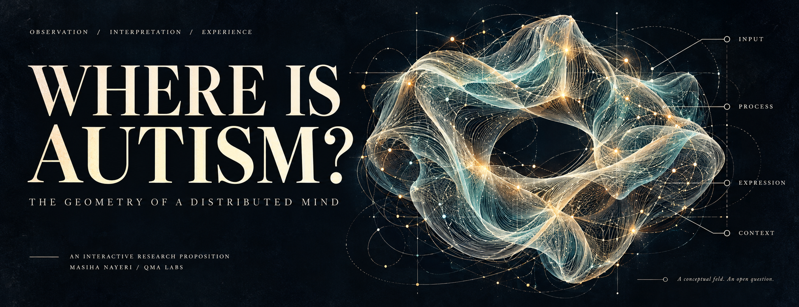
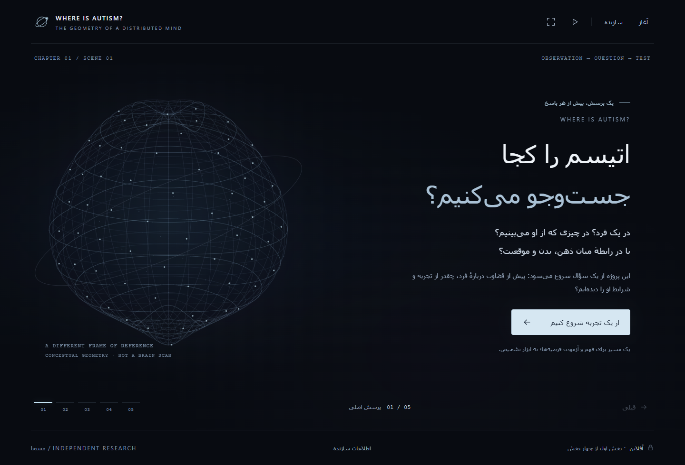
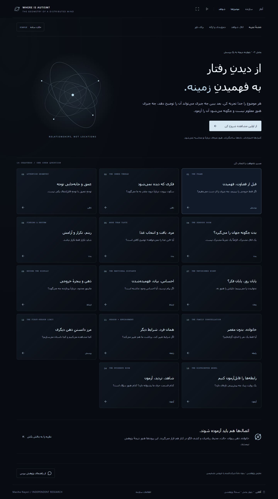
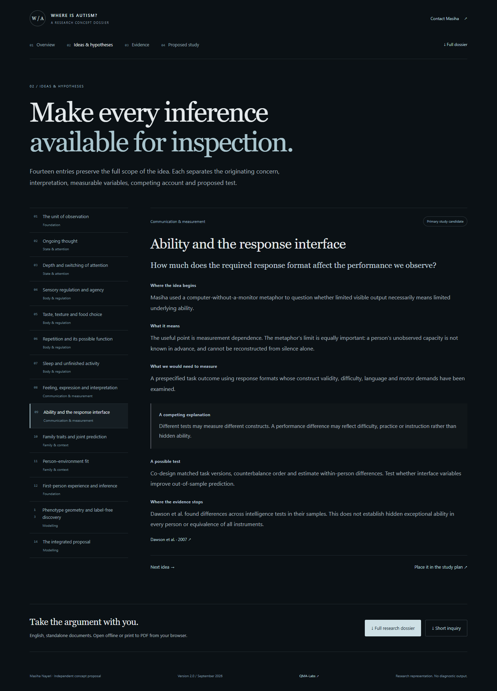
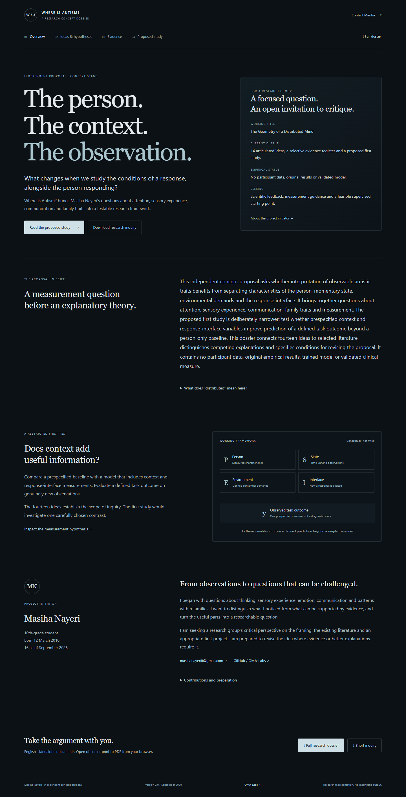

<p align="center"><sub>QMA LABS · INDEPENDENT RESEARCH · AN OPEN QUESTION</sub></p>



<p align="center"><strong>A visible response is an observation.<br>What else do we need to understand it?</strong></p>

<p align="center"><a href="#01--the-question">The question</a> · <a href="#02--enter-the-experience">The experience</a> · <a href="docs/THEORY.md">The framework</a> · <a href="docs/CLAIM-ATLAS.md">14 ideas</a> · <a href="#05--run-it-yourself">Run the source</a> · <a href="README.fa.md">فارسی</a></p>

---

## 01 / The question

**Where Is Autism?** is Masiha Nayeri’s independent research proposition, expressed as an interactive application. Its working title, **The Geometry of a Distributed Mind**, asks us to examine the relationships around an observation: the person, their momentary state, the environment and the way a response is requested.

Imagine the same person completing a task in two settings, through two response formats. If the result changes, what changed—and what can we reasonably infer about the person?

This question becomes a journey through attention, sensory experience, communication, family traits and the limits of interpretation.

> **The proposal in one sentence**  
> Test whether carefully defined context and response-interface measurements add useful predictive information beyond a person-only baseline.

“Distributed” describes the **distribution of relevant observations across conditions and measurements**. It does not relocate autism into other people or make family members responsible for it. “Geometry” names a proposed way of organizing relationships; the visual forms are conceptual, not discovered biological structures.

**Current stage:** an untested conceptual synthesis, a working software prototype and a proposed first study. No participant dataset, original empirical result, trained AI model or validated diagnostic measure is supplied. Existing research informs individual questions; it does not validate the combined framework.

[Read the argument and its limits →](docs/THEORY.md)

## 02 / Enter the experience

Two complementary ways into the same question: an exploratory Persian experience and a focused English research dossier. Below are **actual application captures**; the cover above is conceptual artwork.

### Experience first. Inspect the explanation second.



The exploratory edition connects **14 chapters** with synthetic visual demonstrations, simple and scientific reading layers, a curated research guide and a six-step synthesis. Change a control, inspect the interpretation, then ask what evidence would be needed. The guide retrieves authored material locally; it does not call an LLM.

<table>
<tr>
<td width="50%"><a href="docs/assets/atlas.png"></a><br><sub>THE ATLAS · Fourteen connected questions</sub></td>
<td width="50%"><a href="docs/assets/hypothesis.png"></a><br><sub>THE DOSSIER · Inspect the inference</sub></td>
</tr>
</table>

### Then read it like a reviewer.

The English edition follows four routes: **Overview → Ideas & hypotheses → Evidence → Proposed study**. Every entry separates observation, interpretation, measurement, an alternative explanation, a possible test and an evidence boundary. A full dossier and a short research inquiry export as standalone documents.

<details>
<summary><strong>Open the English research overview</strong></summary>



</details>

Both portable editions build into local HTML with embedded runtime resources. Reading needs no account or server. External research and contact links need an internet connection.

## 03 / A field of relationships


This is a **measurement proposal**, not a fitted causal model. Family information is a separate exploratory extension, rather than an assumed cause or a validated synergy score.

The fourteen ideas form an atlas, rather than fourteen claims of equal evidential strength:

| Lens | Questions inside it |
| :--- | :--- |
| **Observation & experience** | The unit of observation; ongoing thought; first-person experience |
| **Attention & regulation** | Attention switching; sensory agency; food choice; repetition; sleep |
| **Communication & measurement** | Feeling and expression; ability and the response interface |
| **Person, family & setting** | Measured family traits; person–environment fit |
| **Models & integration** | Phenotype geometry; whether the combined account adds anything |

[Inspect all 14 claims, competing explanations and proposed tests →](docs/CLAIM-ATLAS.md)

## 04 / A question that can fail

An appealing framework earns research value through a specific comparison. The proposed starting point is intentionally narrower than the atlas.

**Research question**  
Do prespecified context and response-interface variables improve prediction of a defined task outcome on held-out participants, beyond a person-only baseline?

| Before data collection | During evaluation | What would weaken the claim? |
| :--- | :--- | :--- |
| Co-design accessible outcomes. Define a baseline, candidate variables and minimum useful improvement. Establish suitable consent and review. | Match task demands and counterbalance conditions. Keep each person and family within one data split. Report uncertainty. | Negligible improvement, instrument dependence, disappearance after appropriate adjustment, or failure to replicate independently. |

These are **proposed steps**, not a completed study or preregistration. Predictive improvement alone would not establish causality. Sample size, instruments and the final protocol remain open decisions.

The application includes a **selective register of 11 sources**, with links and claim-specific limits. Differing findings stay visible. The register is not a systematic literature review.

[Research agenda →](docs/RESEARCH-AGENDA.md) · [Source register →](docs/REFERENCES.md)

## 05 / Run it yourself

**Node.js 22.18+ and npm.**

```sh
git clone https://github.com/QMA-Labs/Where-Is-Autism.git
cd Where-Is-Autism
npm ci
npm run build:portable
```

Open the generated HTML directly in a browser:

| Edition | Individual build command | Open after building |
| :--- | :--- | :--- |
| Persian exploratory experience | `npm run build:experience` | `outputs/where-is-autism-complete/index.html` |
| English research dossier | `npm run build:research` | `outputs/where-is-autism-research-edition/index.html` |
| Web development | `npm run dev` | Local address printed by the server |

The research build also writes the full dossier and short inquiry as standalone HTML. Browser print can save those documents as PDF.

[Build instructions, checks and architecture →](docs/DEVELOPMENT.md)

## 06 / Open the source. Challenge the idea.

Content, interaction and presentation remain separate:

```text
app/journey-data.ts             Persian topics and source relationships
app/ExperienceLab.tsx           Synthetic conceptual demonstrations
app/JourneyGuide.tsx            Authored research-guide retrieval
portable/Explorer.tsx           Persian chapter and evidence navigation
portable/research-en-data.ts    English claims, sources and proposed study
portable/ResearchEdition.tsx    English reviewer-facing application
portable/research-documents.ts  Standalone dossier and inquiry exports
docs/                          Framework, claim atlas and development notes
```

The strongest contribution may be an objection: a better existing explanation, an unsuitable measure, a missing source, a failed prediction, or a clearer way for the person being studied to be heard.

[How to contribute a useful critique →](CONTRIBUTING.md) · [Open a research question](https://github.com/QMA-Labs/Where-Is-Autism/issues/new?template=research-question.yml)

---

**Initiated by Masiha Nayeri · [QMA Labs](https://github.com/QMA-Labs)**  
Originating observations and questions: Masiha Nayeri. AI tools assisted with text organization, English drafting, software implementation and cover artwork. Independent scientific review, institutional endorsement and established research novelty are not claimed.

<p align="center"><sub>LOOK CLOSELY. NAME THE INFERENCE. LEAVE ROOM TO BE WRONG.</sub></p>

