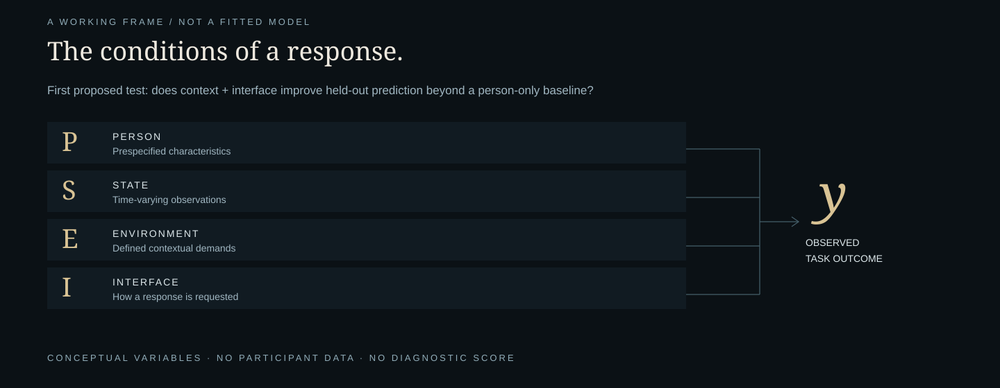

# The Geometry of a Distributed Mind

[← Project](../README.md) · [Claim atlas](CLAIM-ATLAS.md) · [Research agenda](RESEARCH-AGENDA.md)

## The motivating question

A person’s response becomes visible through a particular task, setting, moment and means of expression. How much information do we lose when those conditions are left out of our interpretation?

Masiha Nayeri’s proposition brings attention, sensory experience, emotional expression, communication, family traits and environment into one explicit frame. Its present contribution is the organization of questions and an application for inspecting them. Novelty and empirical value remain open.

## The proposed observation frame

Let **P** denote prespecified person-level measurements, **S** time-varying state observations, **E** a defined environmental demand and **I** a response interface. Let **y** be one chosen task outcome. These symbols organize candidate measurements; they do not define a validated scale.

The first proposed comparison is a person-only baseline against a context/interface-enriched predictor of **y**. State variables need separate definitions and may be controls or later extensions. Does added information improve a prespecified outcome on new observations by a meaningful amount?

No coefficient, geometry, latent capacity or causal pathway is established by drawing this frame. Better prediction alone would not explain the biological basis of autism.

## Why “distributed”?

Relevant observations may be distributed across moments, settings, response methods and—if a separate study justifies collecting them—family measurements. The term does not claim that autism is outside a person, dispersed among relatives or caused by parenting. Individual impairments and support needs remain real.

## Why “geometry”?

Geometry offers a possible vocabulary for relationships among measured features. Before a data-based representation, features need provenance, reliable instruments, appropriate scaling and explicit handling of missingness. A convincing embedding could reflect nuisance variables or analytic choices. Stable structure and independent evaluation would be needed before interpreting a pattern.

The flowing forms in the cover and application are **visual metaphors**, not scans, participant data, discovered phenotypes or model results.

## The monitor metaphor—and where it stops

The originating computer-without-a-monitor metaphor asks whether limited visible response can be confused with a complete account of ability. It motivates examining the response interface. It cannot establish what someone’s unobserved abilities are. Instruments may measure different constructs; neither low ability nor exceptional ability follows from silence alone.

## Three records, kept distinct

| Record | What belongs there |
| --- | --- |
| Observation | What happened, under specified conditions, with a defined measure |
| First-person account | What the person reports through an accessible method they choose |
| Interpretation | An explanation proposed by an observer, including uncertainty and rival accounts |

An unavailable first-person account stays unavailable. The framework does not fill that gap with an invented description of experience.

## Core, extensions, boundaries

The empirical starting point concerns **context and response-interface effects on a defined outcome**. Family prediction, sensory dimensions, attention states and feature-space geometry are distinct extensions. Questions about inaccessible subjective experience mark a philosophical boundary rather than furnish a clinical mechanism.

The [14-entry claim atlas](CLAIM-ATLAS.md) preserves these distinctions. A theory, qualitative account, association and untested hypothesis are different forms of support.

## A framework worth revising

The claim should narrow or fail if added information gives negligible improvement, depends on one instrument, disappears under appropriate adjustment or does not replicate. A simpler explanation that predicts equally well remains a serious competitor.

**Status:** independent concept proposal and working software prototype. No participant data, trained model, validated metric or original empirical result is supplied. This explains the proposition rather than presenting a peer-reviewed theory.

